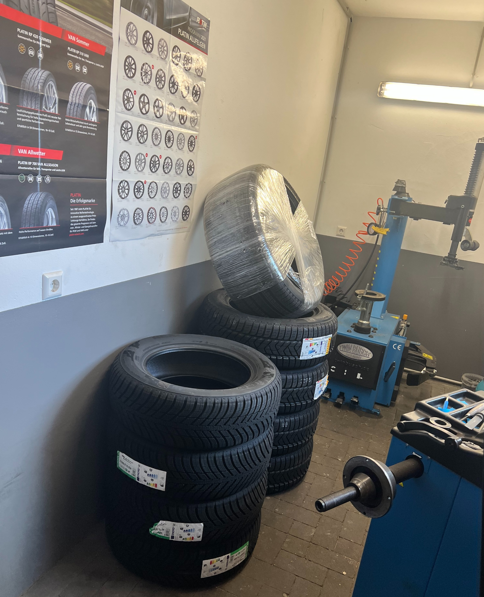
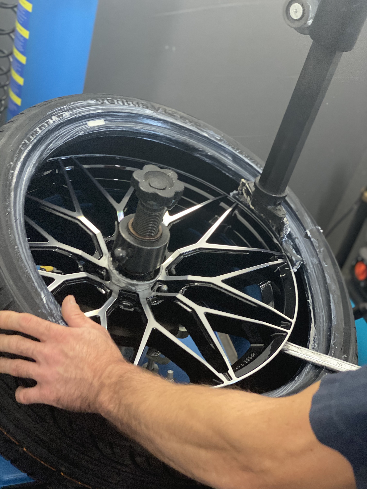
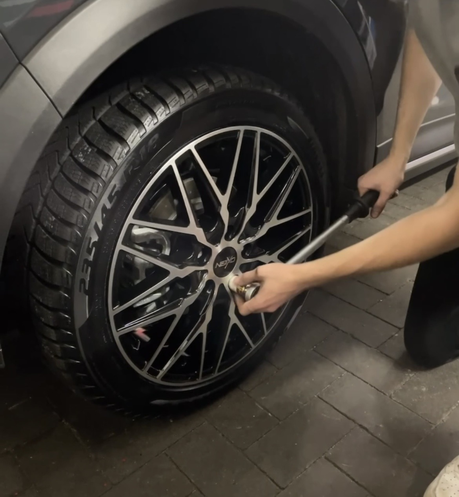
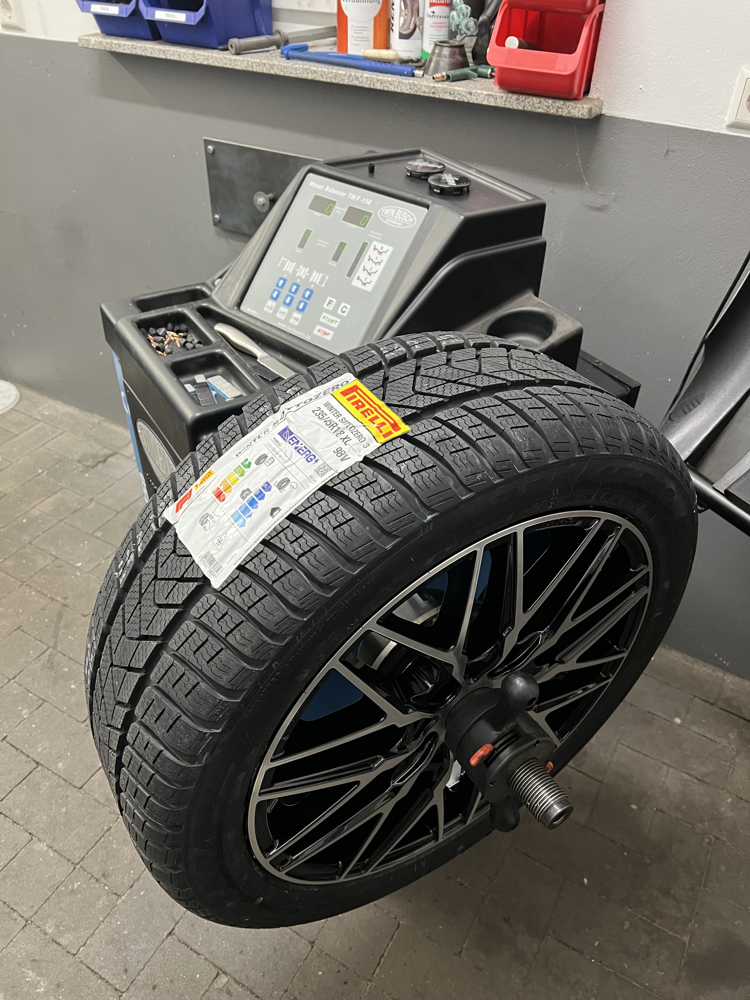
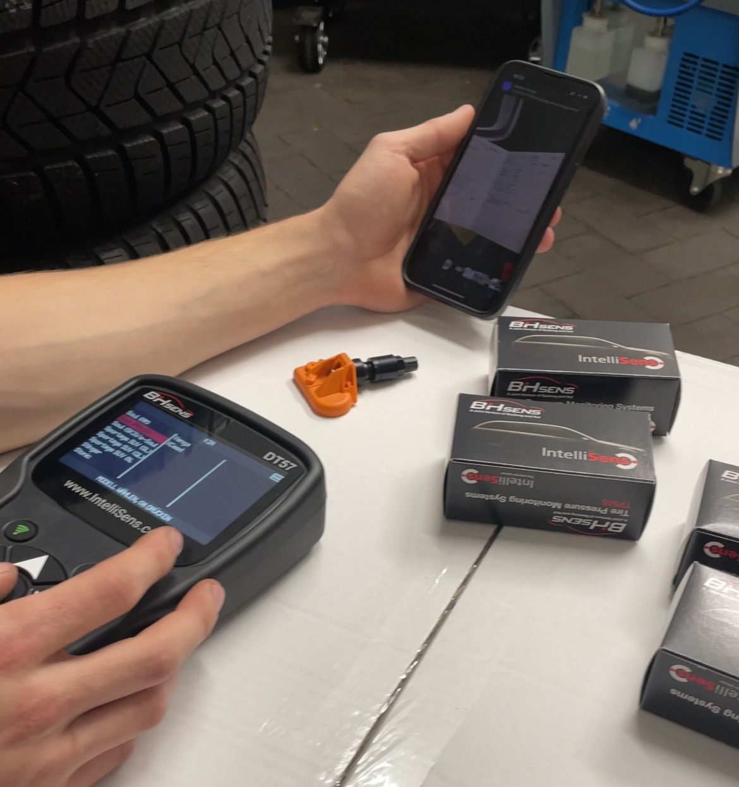
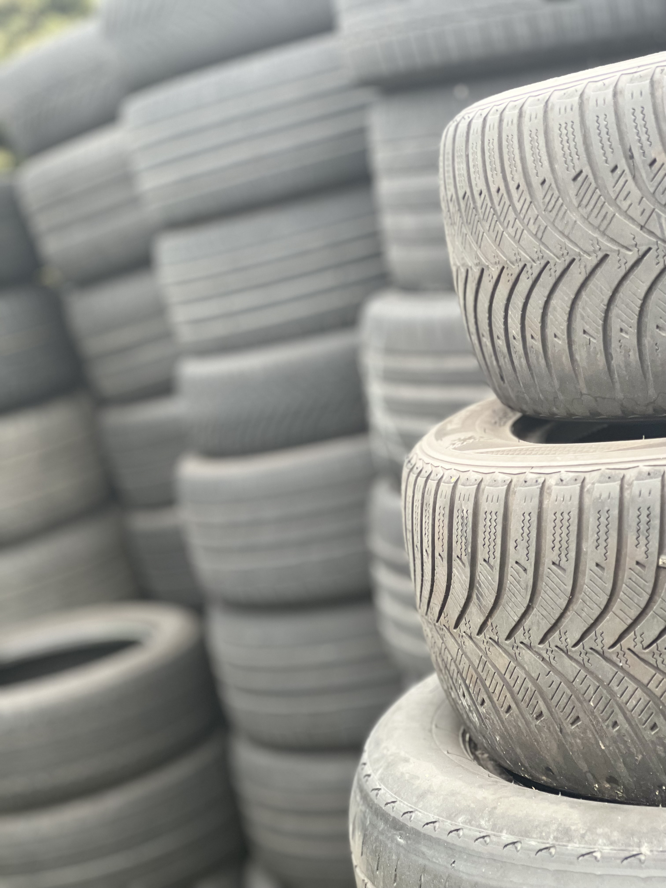

# Reifenservice

Wir bieten Ihnen eine riesige Auswahl passender Reifen. Mit uns fahren Sie gut und vor allem sicher! Wir führen Reifen fast aller Hersteller. Natürlich bestellen wir auch gerne das gewünschte Modell für Sie, falls wir etwas nicht auf Lager haben sollten. Kommen Sie zu uns und lassen Sie sich beraten. Wir sind Spezialisten und wissen über sämtliche Neuigkeiten Bescheid. Sowohl bei den Produkten als auch bei den gesetzlichen Bestimmungen.

## Unsere Preise

### Reifenmontage inkl. Wuchten, Montieren und Luftdruck prüfen

bis 17 Zoll 12,50 € 18 und 19 Zoll 15,00 € ab 20 Zoll 17,50 €

### Radwechsel

### Rad wechseln, Luftdruck und Profiltiefe prüfen

Pkw 25,00 € Transporter 30,00 €

### Auswuchten Rad auswuchten inkl. Auswuchtgewichte

Stahlfelge 5,00 € Alufelge 7,50 €

### RDKS - Sensoren

4 RDKS Sensoren anlernen 15,00 € 4 RDKS Sensoren programmieren 25,00€

### Altreifenentsorgung PKW und Kleintransporter Altreifen entsorgen

**Pro Reifen 3,00€**
