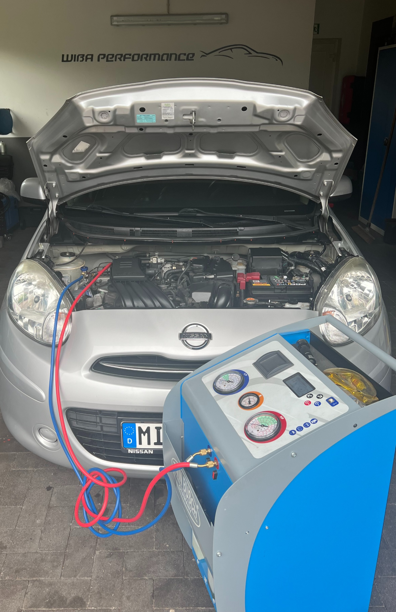

# Klimaservice

Die Klimaanlage kühlt nicht richtig ? Wir regeln das !

Im Sommer und Winter frische und saubere Luft mit dem Auto Klimaservice bei WIBA Performance. Eine Klimaanlage ist nicht wartungsfrei. Sie verliert pro Jahr 15% Kältemittel, dessen Verlust ausgeglichen werden muss, um die volle Funktionsfähigkeit der Klimaanlage zu gewährleisten. Desinfektion schützt vor Bakterien und Schimmelbefall.

## Klimaanlage Befüllung

**R134a - 120,00 €**

## Klimaanlage Befüllen und Desinfektion

**R134a - 150,00 €**

## Klimaanlage Druckprüfung

**ab 40,00 €**
