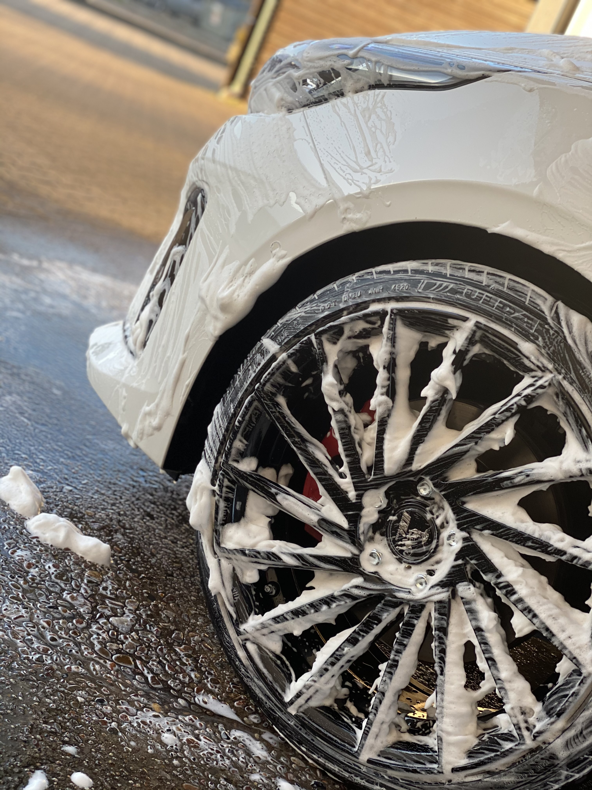

# Datenschutzerklärung

WIBA Performance Felgen- und Reifenhandel Witali Bakin

Allgemeine Geschäftsbedingungen (AGB)

§1 Geltungsbereich

(1) Diese Allgemeinen Geschäftsbedingungen gelten für alle Verträge zwischen dem Anbieter und seinen Kunden.

(2) Sie gelten sowohl für Privatkunden als auch für Geschäftskunden.

(3) Abweichende Bedingungen des Kunden werden nicht anerkannt, es sei denn, der Anbieter stimmt diesen ausdrücklich schriftlich zu.

§2 Leistungen

(1) Der Anbieter erbringt Dienstleistungen im Bereich Felgen- und Reifenhandel, Ersatzteilhandel, Klimaservice, Fahrzeugaufbereitung sowie weitere Kfz-Dienstleistungen.

(2) Zusätzlich erfolgt der Verkauf von Neu- und Gebrauchtwaren sowie Ersatzteilen.

(3) Beratungen erfolgen nach bestem Wissen, stellen jedoch keine Garantie für bestimmte Ergebnisse dar und ersetzen keine Herstellerangaben.

§3 Vertragsschluss

(1) Verträge kommen durch persönliche, telefonische, schriftliche oder elektronische Bestellung (z. B. WhatsApp, E-Mail, Online-Plattformen) zustande.

(2) Angebote sind freibleibend, sofern sie nicht ausdrücklich als verbindlich gekennzeichnet sind.

(3) Mit Auftragserteilung erkennt der Kunde diese AGB an.

§4 WhatsApp-, Telefon- und Fernbestellungen

(1) Bestellungen über WhatsApp, Telefon oder andere elektronische Kommunikationsmittel gelten als verbindlich.

(2) Der Kunde ist verpflichtet, alle fahrzeug- und auftragsrelevanten Daten korrekt anzugeben.

(3) Der Anbieter übernimmt keine Haftung für Falschbestellungen aufgrund fehlerhafter oder unvollständiger Kundenangaben.

(4) Screenshots, Chatverläufe oder Sprachaufzeichnungen können als Vertragsnachweis dienen.

§5 Preise und Zahlung

(1) Alle Preise verstehen sich in Euro inklusive der gesetzlichen Mehrwertsteuer, sofern nicht anders angegeben.

(2) Rechnungen sind sofort nach Leistungserbringung bzw. Warenübergabe ohne Abzug fällig.

(3) Der Anbieter behält sich vor, Vorkasse oder angemessene Anzahlungen zu verlangen.

(4) Bei Zahlungsverzug können Verzugszinsen und Mahngebühren gemäß den gesetzlichen Vorschriften berechnet werden.

§6 Stornierung, Rücksendung & Wiedereinlagerung

(1) Eine Stornierung nach verbindlicher Bestellung ist nur mit Zustimmung des Anbieters möglich.

(2) Bereits bestellte oder beschaffte Waren sind vom Umtausch ausgeschlossen, sofern sie nicht mangelhaft sind.

(3) Im Falle einer genehmigten Stornierung trägt der Kunde sämtliche Kosten für Rücksendung, Transport sowie eine angemessene Wiedereinlagerungsgebühr.

(4) Sonderbestellungen und individuell konfigurierte Waren sind grundsätzlich von der Stornierung ausgeschlossen.

§7 Eigentumsvorbehalt

Gelieferte Waren bleiben bis zur vollständigen Bezahlung Eigentum des Anbieters.

§8 Termine und Ausfallpauschale

(1) Vereinbarte Werkstatt- oder Servicetermine sind verbindlich.

(2) Terminabsagen müssen mindestens 24 Stunden vor dem vereinbarten Termin erfolgen.

(3) Bei Nichterscheinen oder verspäteter Absage behält sich der Anbieter vor, eine Ausfallpauschale in Höhe von 50,00 € zu berechnen.

§9 Umgang mit Kundenfahrzeugen

(1) Kundenfahrzeuge werden mit größtmöglicher Sorgfalt behandelt.

(2) Für bereits vorhandene Schäden oder altersbedingte Abnutzungen wird keine Haftung übernommen.

(3) Wertsachen sind vor Fahrzeugabgabe zu entfernen. Für deren Verlust wird keine Haftung übernommen.

§10 Haftung bei Fremdteilen

(1) Werden vom Kunden beigestellte Teile („Fremdteile“) verbaut, erfolgt dies ausschließlich auf Risiko des Kunden.

(2) Für Qualität, Passgenauigkeit, Haltbarkeit und Folgeschäden durch Fremdteile übernimmt der Anbieter keine Haftung.

(3) Eine Gewährleistung für Arbeitsleistungen entfällt, sofern ein Mangel auf das beigestellte Teil zurückzuführen ist.

§11 Gewährleistung und Haftung

(1) Es gelten die gesetzlichen Gewährleistungsrechte.

(2) Bei gebrauchten Waren kann die Gewährleistung auf ein Jahr verkürzt werden, sofern gesetzlich zulässig.

(3) Der Anbieter haftet nur für Vorsatz und grobe Fahrlässigkeit, außer bei Verletzung wesentlicher Vertragspflichten.

(4) Eine Haftung für mittelbare Schäden oder Folgeschäden ist ausgeschlossen, soweit gesetzlich zulässig.

§12 Reklamationen

Reklamationen sind unverzüglich nach Feststellung, spätestens jedoch innerhalb von 7 Tagen nach Übergabe, mitzuteilen.

§13 Widerrufsrecht

(1) Verbrauchern steht bei Fernabsatzverträgen ein gesetzliches Widerrufsrecht zu.

(2) Das Widerrufsrecht erlischt bei Dienstleistungen, die vollständig erbracht wurden.

(3) Waren, die speziell für den Kunden bestellt oder angefertigt wurden, sind vom Widerruf ausgeschlossen.

§14 Datenschutz

Die Verarbeitung personenbezogener Daten erfolgt gemäß den gesetzlichen Datenschutzbestimmungen (DSGVO). Eine separate Datenschutzerklärung ist verfügbar.

§15 Gerichtsstand und Recht

(1) Für Kaufleute ist Gerichtsstand der Sitz des Anbieters.

(2) Es gilt ausschließlich deutsches Recht.

§16 Salvatorische Klausel

Sollte eine Bestimmung dieser AGB unwirksam sein oder werden, bleibt die Wirksamkeit der übrigen Bestimmungen unberührt.

Datenschutzerklärung

1. Verantwortlicher

Verantwortlich für die Datenverarbeitung:

WIBA Performance

Hackelbarg 7

32369 Rahden

05776/3060088

Info@wibaperformance.de

⸻

2. Allgemeine Hinweise

Der Schutz deiner persönlichen Daten ist uns wichtig.

Wir behandeln deine personenbezogenen Daten vertraulich und entsprechend der gesetzlichen Datenschutzvorschriften (DSGVO).

⸻

3. Erhebung und Speicherung personenbezogener Daten

Wir verarbeiten personenbezogene Daten, wenn du:

• unsere Website besuchst

• Kontakt mit uns aufnimmst

• eine Bestellung tätigst

• an einem Gewinnspiel teilnimmst

Dabei können folgende Daten erhoben werden:

• Name

• Adresse

• Telefonnummer

• E-Mail-Adresse

• Fahrzeugdaten

• Zahlungsdaten

⸻

4. Zweck der Datenverarbeitung

Die Daten werden verwendet für:

• Vertragsabwicklung

• Terminvereinbarung

• Rechnungsstellung

• Kundenbetreuung

• Durchführung von Gewinnspielen

• Gesetzliche Pflichten

⸻

5. Weitergabe von Daten

Eine Weitergabe deiner Daten erfolgt nur, wenn:

• dies gesetzlich erlaubt ist

• es zur Vertragsabwicklung nötig ist

• du eingewilligt hast

(z. B. an Steuerberater, Lieferanten, Versandunternehmen)

⸻

6. Speicherung der Daten

Deine Daten werden nur so lange gespeichert, wie es gesetzlich erforderlich ist oder für den Zweck notwendig ist.

⸻

7. Rechte der betroffenen Personen

Du hast jederzeit das Recht auf:

• Auskunft

• Berichtigung

• Löschung

• Einschränkung der Verarbeitung

• Datenübertragbarkeit

• Widerruf deiner Einwilligung

Anfragen kannst du richten an:

[E-Mail-Adresse]

⸻

8. Kontaktformular / WhatsApp / Telefon

Wenn du uns per:

• Telefon

• WhatsApp

• E-Mail

• Kontaktformular

kontaktierst, werden deine Angaben zur Bearbeitung gespeichert.

Diese Daten geben wir nicht ohne deine Einwilligung weiter.

⸻

9. Cookies & Website

Unsere Website kann Cookies verwenden, um die Nutzung zu verbessern.

Du kannst Cookies in deinem Browser deaktivieren.

⸻

10. Gewinnspiele

Bei Gewinnspielen werden deine Daten ausschließlich zur Durchführung verwendet und anschließend gelöscht.

⸻

11. Datensicherheit

Wir verwenden technische und organisatorische Maßnahmen, um deine Daten zu schützen.

⸻

12. Änderungen der Datenschutzerklärung

Wir behalten uns vor, diese Datenschutzerklärung anzupassen, wenn sich rechtliche Vorgaben ändern.
